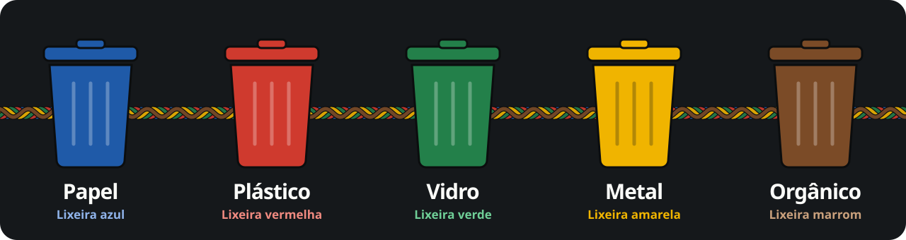
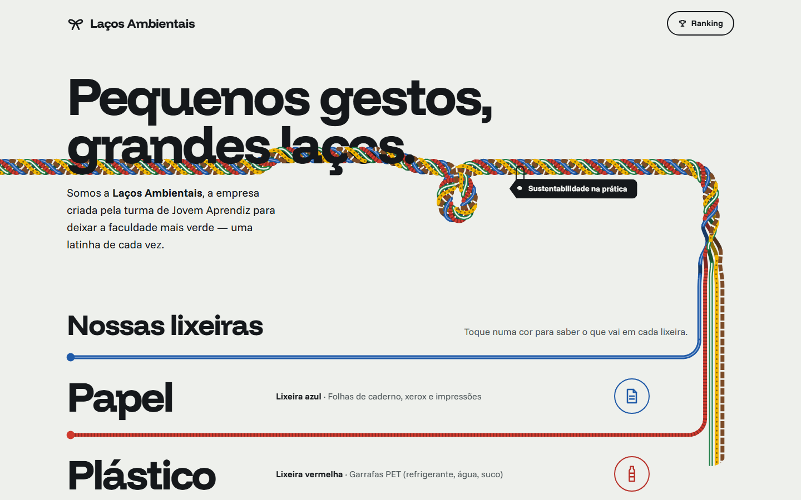
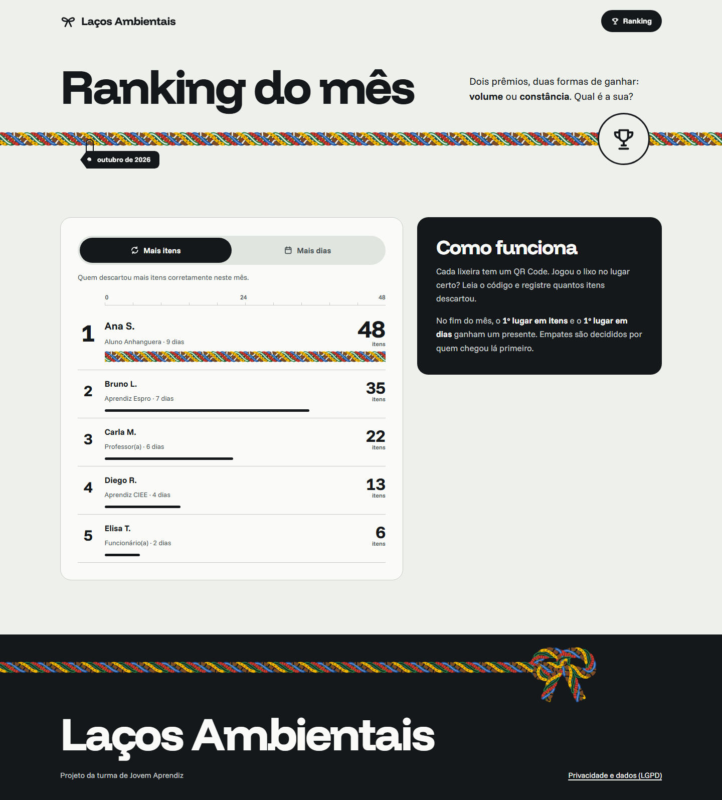
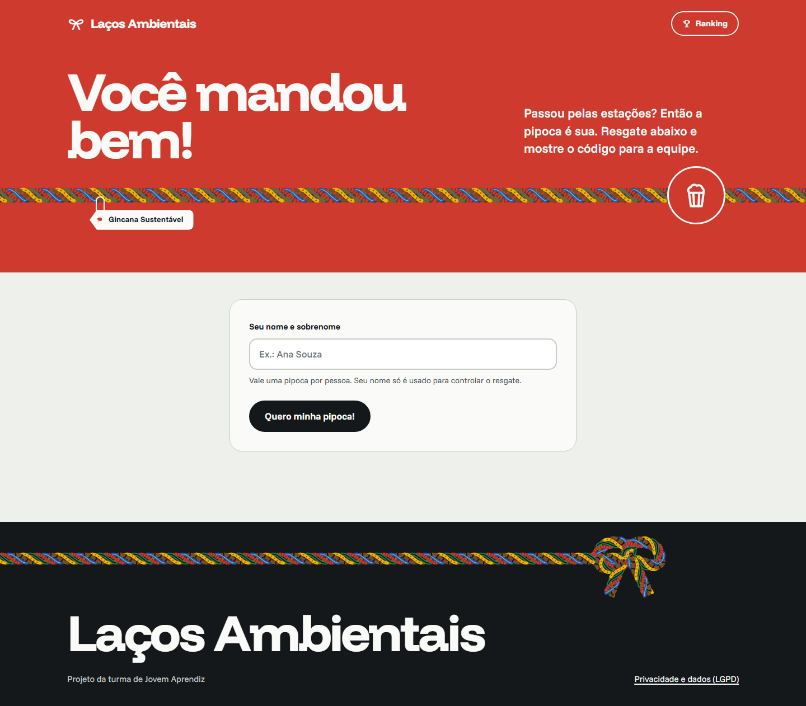
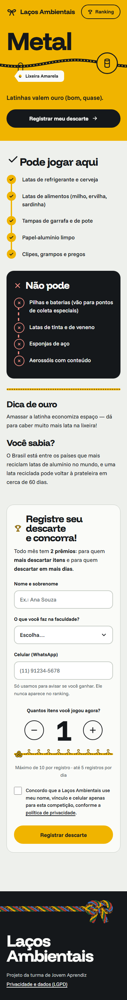
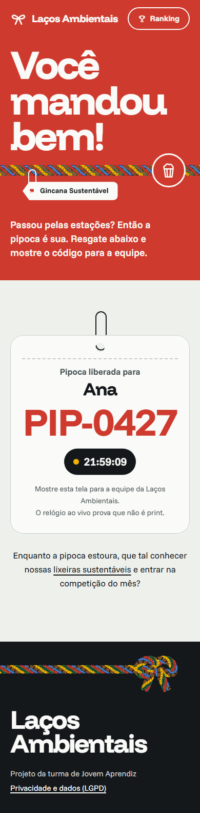
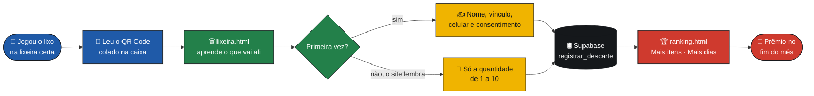
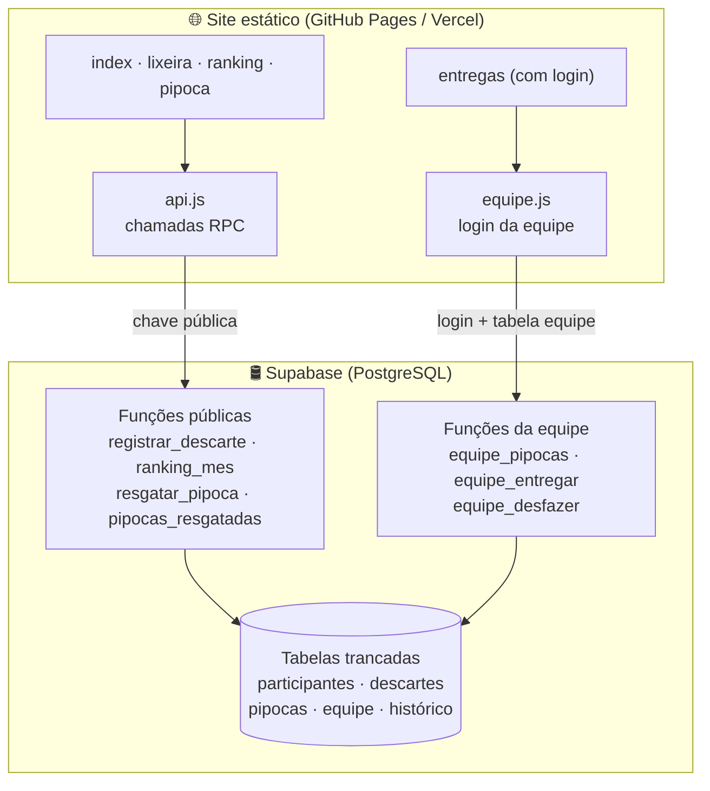
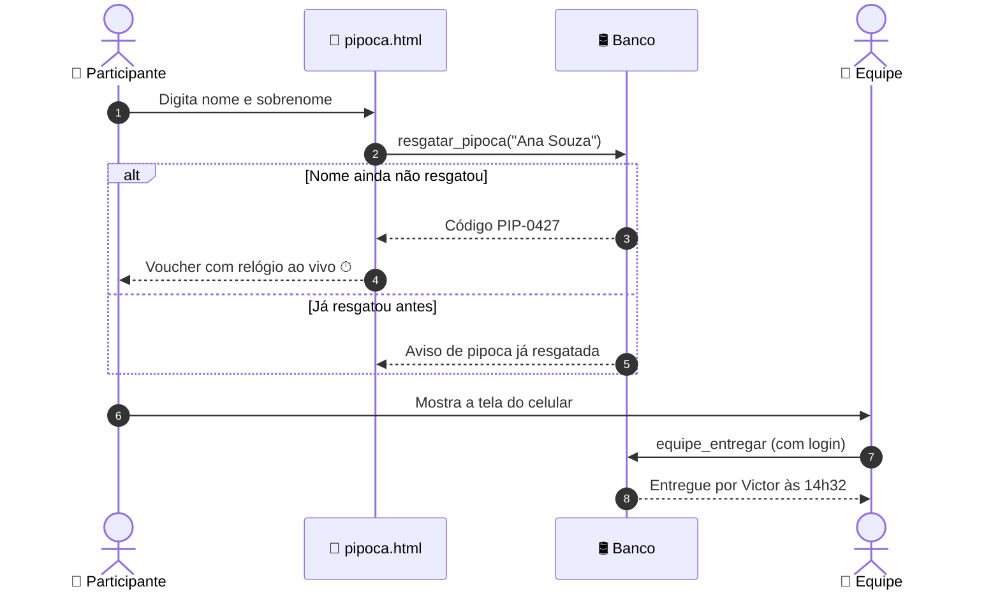

<div align="center">



<br>

<a href="#-sobre-o-projeto">
  
</a>

<br><br>


<br><br>

**[Sobre](#-sobre-o-projeto)** ·
**[Lixeiras](#-as-cinco-lixeiras)** ·
**[Páginas](#-tour-pelas-páginas)** ·
**[Como funciona](#-como-tudo-se-conecta)** ·
**[Competição](#-competição-do-mês)** ·
**[Pipoca](#-gincana-da-pipoca)** ·
**[Segurança](#-privacidade-e-segurança)** ·
**[Design](#-design-o-cordão)** ·
**[Rodar](#-como-rodar-e-publicar)**

</div>


## 🌱 Sobre o projeto

> **Laços Ambientais** é uma empresa criada pela turma de **Jovem Aprendiz (Espro — Turma 16219)** com uma missão simples: deixar a faculdade mais verde, *uma latinha de cada vez*.

Espalhamos **lixeiras de coleta seletiva** pelo campus, cada uma com um **QR Code**. Quem descarta algo lê o código com o celular e cai direto num site que:

<table>
<tr>
<td width="25%" align="center">📚<br><b>Ensina</b><br><sub>o que pode e o que não pode em cada lixeira</sub></td>
<td width="25%" align="center">🏆<br><b>Premia</b><br><sub>quem mais descarta e quem descarta em mais dias</sub></td>
<td width="25%" align="center">🎮<br><b>Diverte</b><br><sub>com o jogo “Onde isso vai?” e a gincana da pipoca</sub></td>
<td width="25%" align="center">🔒<br><b>Protege</b><br><sub>os dados de todo mundo, seguindo a LGPD</sub></td>
</tr>
</table>

Tudo pensado para o **celular**, numa mão só, nos 10 segundos depois de jogar o lixo fora.

## ♻ As cinco lixeiras

<div align="center">

</div>

<br>

As cores seguem a resolução **CONAMA 275** e viraram a própria linguagem visual do site: cada lixeira tem sua página, sua cor e até sua própria “trama” no cordão.

| | Lixeira | Cor | Vai aqui | Não vai aqui |
|:-:|---|---|---|---|
| 📰 | **Papel** |  | Folhas, jornais, papelão, caixas longa vida | Papel engordurado, molhado ou usado |
| 🥤 | **Plástico** |  | Garrafas PET, copos, potes, sacolas | Embalagens metalizadas, com resto de comida |
| 🥛 | **Vidro** |  | Garrafas, potes, frascos vazios | Espelhos, lâmpadas, cerâmica, telas |
| 🥫 | **Metal** |  | Latinhas, latas de alimento, tampas | Pilhas, latas de tinta, aerossóis |
| 🍌 | **Orgânico** |  | Cascas, restos de comida, borra de café | Embalagens, bitucas de cigarro |

<sub>A lista completa, com dicas e curiosidades de cada lixeira, fica em <code>LIXOS</code> dentro de <a href="assets/js/lacos.js"><code>assets/js/lacos.js</code></a>.</sub>


## 🗺 Tour pelas páginas

<div align="center">

<br><sub><b>Página inicial</b> — o cordão de cinco cores corre pela tela e se abre nas cinco lixeiras</sub>
</div>

<br>

| Página | O que faz | Quem usa |
|---|---|---|
| 🏠 [`index.html`](index.html) | Apresenta a empresa, as 5 lixeiras, o jogo **“Onde isso vai?”** e o **top 3 ao vivo** do ranking | Todo mundo |
| 🗑 [`lixeira.html?tipo=…`](lixeira.html) | Pode / não pode, dica e curiosidade da lixeira + **formulário para registrar o descarte** | Quem lê o QR Code da caixa |
| 🏆 [`ranking.html`](ranking.html) | Top do mês em duas categorias: **Mais itens** e **Mais dias** | Todo mundo |
| 🍿 [`pipoca.html`](pipoca.html) | Resgate da pipoca da gincana (uma por nome) com voucher **anti-print** | Quem terminou as estações |
| 🔐 [`privacidade.html`](privacidade.html) | Política de privacidade em linguagem simples (LGPD) | Link no formulário |
| 🖨 [`qrcodes.html`](qrcodes.html) | Gera as **6 folhas A4** com QR Code para imprimir e colar | Só a equipe |
| 📋 [`entregas.html`](entregas.html) | Painel com login para controlar a **entrega das pipocas** | Só a equipe |

<details>
<summary><b>📸 Ver mais telas (clique para abrir)</b></summary>
<br>

<table>
<tr>
<td align="center" width="50%">
<br>
<sub><b>Ranking do mês</b> — o 1º lugar ganha a barra trançada</sub>
</td>
<td align="center" width="50%">
<br>
<sub><b>Pipoca</b> — “Você mandou bem!”</sub>
</td>
</tr>
<tr>
<td align="center">
<br>
<sub><b>Lixeira de metal</b> no celular, com o contador de itens em forma de cordão</sub>
</td>
<td align="center">
<br>
<sub><b>Voucher da pipoca</b> — o relógio ao vivo prova que não é print</sub>
</td>
</tr>
</table>

<sub>As telas usam dados de exemplo (modo demonstração).</sub>
</details>


## 🔗 Como tudo se conecta

A jornada de quem participa, do lixo na mão até o pódio:



### Arquitetura em uma imagem

O site é **100% estático** (HTML, CSS e JavaScript puro, sem build). Toda a lógica que precisa ser confiável mora **dentro do banco**, em funções SQL:



> [!TIP]
> **Sem banco configurado? Sem problema.** O site já nasce em **modo demonstração**: os dados ficam guardados só no navegador de quem está testando. Dá para mostrar tudo funcionando antes de criar a conta no Supabase.


## 🏆 Competição do mês

Dois prêmios, duas formas de ganhar: **volume** ou **constância**. Qual é a sua?

<table>
<tr>
<td width="50%" valign="top">

### 🔁 Mais itens
Soma de todos os itens que a pessoa registrou no mês.

</td>
<td width="50%" valign="top">

### 📅 Mais dias
Quantidade de **dias diferentes** em que a pessoa registrou algo no mês.

</td>
</tr>
</table>

<details>
<summary><b>📜 Regras completas (já embutidas no banco — ninguém burla pelo navegador)</b></summary>
<br>

| Regra | Valor |
|---|---|
| Itens por registro | de **1 a 10** |
| Registros por pessoa por dia | no máximo **5** |
| Intervalo entre registros | pelo menos **1 minuto** |
| Como a pessoa é identificada | pelo **celular** (no 2º registro o site lembra dela) |
| Desempate | quem tem mais dias (ou mais itens) e, persistindo, **quem chegou primeiro** |
| Virada do ranking | zera sozinho todo dia 1º, no **horário de Brasília** |
| O que aparece no ranking | só **“Ana S.”** e o vínculo — nunca o celular |

<sub>Para mudar os limites, edite a função <code>registrar_descarte</code> em <a href="supabase/schema.sql"><code>supabase/schema.sql</code></a> e o texto de <code>lixeira.html</code>.</sub>
</details>


## 🍿 Gincana da pipoca

Passou por todas as estações da gincana? A pipoca é sua! O resgate foi pensado para ser **rápido para quem participa** e **difícil de trapacear**:



- 🔤 **Um resgate por nome** — “João Silva”, “joao silva” e “JOÃO  SILVA” contam como o mesmo nome.
- ⏱ **Relógio ao vivo** no voucher — se o relógio estiver parado, é print. 😉
- 📜 **Lista pública “Quem já resgatou”** com busca e ordenação, mostrando só “Ana S.” e o horário.
- 🤝 **Sem entrega duplicada** — se duas pessoas da equipe tocarem em *Entregar* ao mesmo tempo, a segunda recebe “Já tinha sido entregue por…”.
- ↩️ **Desfazer com histórico** — todo “desfazer” fica gravado e o site não consegue apagar.
- 📊 **Exportar CSV** direto do painel, para abrir no Excel ou no Google Planilhas.


## 🔒 Privacidade e segurança

Coletamos o mínimo (nome, vínculo e celular) e só com **consentimento explícito**. E a segurança não depende do navegador:

<table>
<tr>
<td width="33%" valign="top">

#### 🧱 Tabelas trancadas
Ninguém lê ou escreve nas tabelas diretamente. A chave pública do site só consegue chamar **4 funções** específicas.

</td>
<td width="33%" valign="top">

#### 🕵️ Nada de dados expostos
Ranking e lista da pipoca mostram só **primeiro nome + inicial**. Celular **nunca** sai do banco para o público.

</td>
<td width="33%" valign="top">

#### 🔑 Equipe com login de verdade
O painel `entregas.html` é só uma “casca”: os dados só aparecem para quem fez **login no Supabase** *e* está na tabela `equipe`.

</td>
</tr>
</table>

> [!IMPORTANT]
> A chave que fica no [`config.js`](assets/js/config.js) é a **publishable / anon**, pública por natureza. **Nunca** coloque a chave *secret* / *service_role* no site.

Ao fim da campanha, uma consulta pronta em [`consultas-equipe.sql`](supabase/consultas-equipe.sql) **apaga todos os dados**, cumprindo o prazo prometido na [política de privacidade](privacidade.html).


## 🎨 Design: o cordão

A identidade inteira nasce de uma ideia: **um cordão de cinco fios**, um para cada lixeira, que amarra o campus a cada caixa de coleta. Ele é desenhado em SVG por [`cordao.js`](assets/js/cordao.js) e aparece de vários jeitos:

| Onde | Como o cordão aparece |
|---|---|
| Abertura da home | atravessa o título, dá um nó e se divide nas cinco lixeiras |
| Lista de lixeiras | cada fio vira uma “pista” da sua cor |
| Contador de itens | os nós vão sendo amarrados conforme a quantidade sobe |
| Ranking | o 1º lugar ganha a barra trançada |
| Rodapé e sucesso | termina num laço 🎀 |

<details>
<summary><b>🖌 Paleta e tipografia</b></summary>
<br>

| Token | Cor | Uso |
|---|---|---|
| `tinta` |  | Texto e painéis escuros |
| `chao` |  | Fundo das páginas |
| `azul` |  | Papel |
| `vermelho` |  | Plástico |
| `verde` |  | Vidro |
| `amarelo` |  | Metal |
| `marrom` |  | Orgânico |

**Tipografia:** [Funnel Display](https://fonts.google.com/specimen/Funnel+Display) nos títulos (peso 800, bem justinho) e [Funnel Sans](https://fonts.google.com/specimen/Funnel+Sans) no texto — ambas licença OFL e servidas pelo próprio site.

**Acessibilidade:** contraste conferido em todas as cores de lixeira, alvos de toque grandes e `prefers-reduced-motion` respeitado (as animações param para quem pediu menos movimento).

<sub>O sistema de design completo está em <a href="DESIGN.md"><code>DESIGN.md</code></a>.</sub>
</details>


## 🚀 Como rodar e publicar

### 1 · Testar no computador

```bash
# dentro da pasta do projeto
python -m http.server
# abra http://localhost:8000
```

<sub>Ou use a extensão <b>Live Server</b> do VS Code. Sem banco configurado, o site roda em modo demonstração.</sub>

### 2 · Ligar o banco

1. Crie um projeto em [supabase.com](https://supabase.com) (região **São Paulo**).
2. No **SQL Editor**, rode [`supabase/schema.sql`](supabase/schema.sql) e depois [`atualizacao-lista-pipoca.sql`](supabase/atualizacao-lista-pipoca.sql) e [`atualizacao-equipe-pipoca.sql`](supabase/atualizacao-equipe-pipoca.sql).
3. Preencha o único arquivo de configuração, [`assets/js/config.js`](assets/js/config.js):

```js
window.LACOS_CONFIG = {
  SUPABASE_URL: "https://seu-projeto.supabase.co",
  SUPABASE_KEY: "sb_publishable_...",   // nunca a secret!
  RESPONSAVEL: "Espro - Turma 16219 | Empresa Laços Ambientais",
  CONTATO: "lacos.ambientais@gmail.com",
  FIM_CAMPANHA: "31/12/2026",
};
```

### 3 · Publicar

**GitHub Pages:** *Settings → Pages → Branch `main` / `(root)` → Save*. Ou importe o repositório na **Vercel** e clique em *Deploy*: não precisa configurar nada.

### 4 · Imprimir os QR Codes

Abra `qrcodes.html` no site publicado → **Imprimir / salvar PDF** → saem 6 folhas A4 (5 lixeiras + pipoca).

> [!WARNING]
> Decidam o **endereço final antes de imprimir**. Se o site mudar de endereço depois, os QR Codes já colados param de funcionar.

<div align="center">

📖 **O passo a passo completo (equipe, consultas, LGPD) está no [Guia de Publicação — LEIA-ME.md](LEIA-ME.md).**

</div>


## 🗂 Estrutura do projeto

```text
lacos-ambientais/
├── 📄 index.html          → página inicial + jogo "Onde isso vai?"
├── 📄 lixeira.html        → página de cada lixeira + registro
├── 📄 ranking.html        → ranking do mês
├── 📄 pipoca.html         → resgate da pipoca
├── 📄 privacidade.html    → política LGPD
├── 📄 qrcodes.html        → folhas A4 com QR Code (equipe)
├── 📄 entregas.html       → painel de entregas (equipe, com login)
├── 🎨 assets/
│   ├── css/style.css      → todo o visual
│   ├── fonts/             → Funnel Display + Funnel Sans (OFL)
│   └── js/
│       ├── ⭐ config.js   → o ÚNICO arquivo que precisa editar
│       ├── lacos.js       → conteúdo e cores das lixeiras
│       ├── cordao.js      → o cordão trançado em SVG
│       ├── api.js         → conexão com o banco + modo demonstração
│       ├── equipe.js      → login e área da equipe
│       └── qrcode.js      → gerador de QR Code (MIT)
└── 🛢 supabase/
    ├── schema.sql                    → cria o banco (1 vez)
    ├── atualizacao-lista-pipoca.sql  → lista "Quem já resgatou"
    ├── atualizacao-equipe-pipoca.sql → área de entregas
    └── consultas-equipe.sql          → vencedores, relatórios e limpeza LGPD
```


## 💚 Créditos

<div align="center">

Feito com carinho pela **Turma 16219 de Jovem Aprendiz do Espro**,<br>
como a empresa **Laços Ambientais**.

📬 Contato: **lacos.ambientais@gmail.com**

<sub>Fontes Funnel Display e Funnel Sans sob licença SIL OFL · Biblioteca de QR Code sob licença MIT</sub>

<br><br>


</div>


